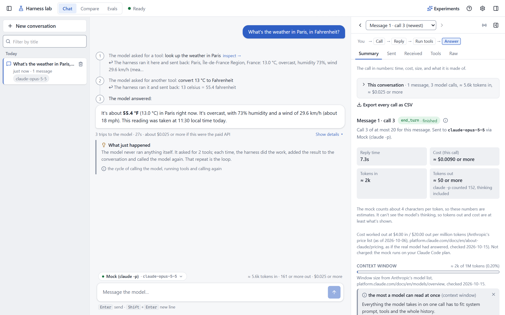

<div align="center">

# Harness lab

**A small AI agent harness you can watch, built to learn how one works.**

[](https://github.com/tanmayjalan/harness-lab/actions/workflows/ci.yml)


[](LICENSE)

[Getting started](docs/getting-started.md) · [Learning path](docs/learning-path.md) · [Tour](docs/tour.md) · [How it's built](docs/architecture.md) · [Safety](docs/safety.md)



</div>

## What is a harness?

A model on its own only reads text and writes text. The **harness** is the ordinary program around it: it
sends the model the conversation and a list of tools, runs the tools the model asks for, sends back the
results, and repeats until the model answers. Claude Code, coding assistants and "AI agents" are all
harnesses.

That repeat is **the loop**, and here it is about eighty lines of Python: `agent()` in
[`harness/core/loop.py`](harness/core/loop.py). This lab wraps it in a web page that shows every model call,
every tool run and every token, so you can see what a harness does instead of reading about it.

## Quick start

You need Windows, Python 3.10+, git, and one of these to get replies from a model:

- a [Claude Code](https://claude.com/claude-code) plan, with Claude Code installed and signed in (the default);
- an API key for the Anthropic API or DeepSeek (paid per use);
- [Ollama](https://ollama.com) or [LM Studio](https://lmstudio.ai), free, running a model on your own computer.

The default is the *mock*: real Claude replies, sent through Claude Code (`claude -p`) instead of the API. It
uses your Claude Code plan, at no extra charge.

Windows only, because `setup.bat`, `start.bat` and `stop.bat` are Windows batch files that run PowerShell
scripts and use the `.venv\Scripts` folder Python makes on Windows. The Python code isn't known to fail
elsewhere, but it hasn't been tried there.

1. Get the code (it makes a `harness-lab` folder):
   ```
   git clone https://github.com/tanmayjalan/harness-lab.git
   cd harness-lab
   ```
2. Run **`.\setup.bat`**. It makes the lab's Python folder, installs the packages and checks everything. It
   also offers to save API keys: that's optional, and Enter skips it.
3. Run **`.\start.bat`**. The page opens at http://127.0.0.1:8000. **`.\stop.bat`** stops it.
4. Click **Watch the loop**. On the mock each model call takes about 5 to 30 s, and the page shows each call
   as it happens.

(Type the `.\` in PowerShell, Windows Terminal's usual shell: there a plain `setup.bat` isn't found.)

With an API key, start with `.\start.bat -Provider anthropic` (or `deepseek`). With Ollama or LM Studio,
`.\start.bat -Provider ollama` (or `lmstudio`). See [Getting started](docs/getting-started.md) for every
option, and [If something goes wrong](docs/getting-started.md#if-something-goes-wrong) if a step fails.

**Getting help:** read the [documentation](docs/README.md), or open an issue with the
[Question](https://github.com/tanmayjalan/harness-lab/issues/new/choose) template.

## What you can try

27 guided experiments in five tiers, each building on the one before ([learning path](docs/learning-path.md)):

| Tier | You'll see |
|---|---|
| **The loop** | call, run tools, call again; errors sent back as answers; retries; replies cut off; runaway tasks stopped |
| **Control and safety** | asking before acting, hooks that block a tool, a file that tries to give orders, Rewind |
| **Size and cost** | the history growing, trimming, prompt caching, several tools at once, fifty tools, finding a tool first |
| **Shaping the model** | thinking, a strict input form, memory, editing a tool's description, switching model mid-chat |
| **Bigger jobs** | helper agents, a chain of agents, write-run-fix, plans, search then read, skills, MCP tools |

Then measure what a change does:

- **Inspector:** open any model call and see exactly what was sent and received, how big it was, what it
  cost, and what your hooks decided.
- **Compare:** one question, up to three setups side by side, each run several times.
- **Re-run:** send a past message again with today's settings.
- **Evals:** fixed questions scored PASS / MIXED / FAIL, with a pass-rate chart over time.
- **Quiz:** check what stuck.

## How it's organised

```
harness/core/       the loop, the tools and the providers: read these first
harness/features/   add-ons to the loop, one idea per file (memory, skills, helpers, hooks, trimming, ...)
harness/web/        the small server behind the page
config/             files you're meant to edit: hooks, skills, MCP servers, eval questions
workspace/          the model's folder, with sample files to experiment on
ui/                 the page's source (React + TypeScript + Tailwind)
tests/              offline tests: no model calls
docs/               the documentation
scripts/            the PowerShell behind setup.bat, start.bat and stop.bat
```

The full map, with one line per file, is in [How it's built](docs/architecture.md#whats-where).

## Documentation

Every page, with what each is for, is listed in [the documentation index](docs/README.md). What changed
recently is in [CHANGELOG.md](CHANGELOG.md).

## Safety, in short

The model's file tools work only in `workspace/` without asking. Writing files, saving facts, running code
and MCP tools ask first. Running code is **not** a sandbox: a script runs as you, so read it before you click
Allow. Everything the model reads is sent to the provider you chose. Details in [Safety rules](docs/safety.md).

## Contributing

Issues and pull requests are welcome. See [CONTRIBUTING.md](CONTRIBUTING.md) and the
[code of conduct](CODE_OF_CONDUCT.md). To report a security problem, see [SECURITY.md](SECURITY.md).

## License

[MIT](LICENSE)
