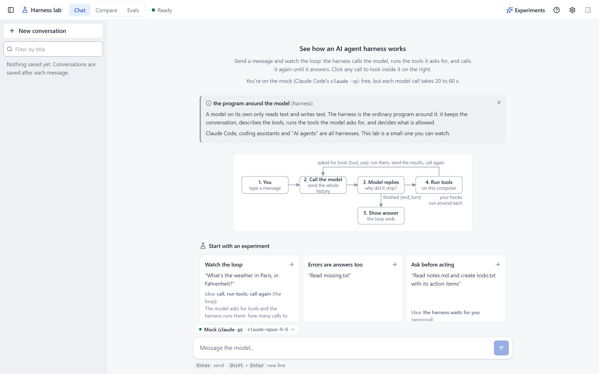

# A tour of the page

Three columns: your conversations on the left, the conversation in the middle, and a look inside one model call
on the right. Along the top: **Chat**, **Compare**, **Evals**, then **Experiments**, **?** and Settings.

- [Conversations (left)](#conversations-left)
- [Chat (middle)](#chat-middle)
- [Inspector (right)](#inspector-right)
- [Settings](#settings)
- [Compare](#compare)
- [Evals](#evals)
- [Help](#help)

## Conversations (left)

Every saved conversation, newest first, with small tags for the setup it last used (model, "prompt edited",
"trimming on" and so on). **New conversation** starts a fresh one. The bin deletes one (click twice; **Undo**
brings it back). Eval runs are saved too, but opened from the Evals screen.

## Chat (middle)

Your message, then each **model call** as a thin line (`Call 2 · asked for 1 tool · 1.8s`), with the tools it
asked for underneath: what the model asked for, whether the harness ran it, and why not if it didn't (your
settings, your hook, you declined, outside the workspace). Click a tool to see its input and result, and what
each of your hooks decided for it. A row is marked when a hook rewrote its result (both versions are shown) or
crashed.

- A helper agent shows as a card with what it read and the short report it sent back; a plan shows as a
  checklist.
- With the workflow on, a Workflow card shows the chain as a diagram, each step's calls sit under its name,
  and each step shows the text your code sent it and what it returned.
- Each idea is explained in full the first time it appears, then shrinks to an ⓘ (its popover leads to the
  glossary).
- An empty conversation offers the **experiments** (also under **Experiments** at the top): each says where
  to look while it runs (with your guess, just above the message box), then what it showed and what to try
  next, right under the answer.
- When a tool needs your OK, the message box is replaced by one **approval** panel: Allow or Decline (keys
  **A** / **D**), and "Always allow" to stop being asked for that tool.
- Above the message box: the provider and model in use (click to switch) and the tokens used so far.
  **Esc** stops a message after the current step (a `run_python` script that is running is ended at once).
- Hover a past message for **Re-run with current settings** (send it again after the same history, and see
  the saved run and the new one side by side) or **Compare this question**.

### Rewind

**Rewind to here**, also under a past message, goes back to before it. A dialog first lists what happens: the
messages that go, the files put back as they were and the files deleted (added since), any file changed since
the conversation's last reply by something else (you, another conversation, Compare or Re-run: rewinding
overwrites it), and what can't be undone. Rewind puts the message back in the message box; if you had typed
something there, it asks before replacing it. There is no Undo: the dialog is the check. Conversations saved
before Rewind existed don't offer it. See [what Rewind can't undo](safety.md#rewind).

## Inspector (right)

The call you clicked, or the newest one. A small loop diagram shows where it ended up.

- **Summary** starts with **This conversation**: calls, tool runs, time spent on the model, the tools and
  waiting for you, tokens, cost, and how big the next call will be at least. **Export every call as CSV**
  gives one row per call.
- Then the call itself: where its time went (on the mock, part of it is starting `claude -p`), how much of
  the model's context window (the most it can read at once) it used, whether the start of the request changed
  since the previous call (if it did, nothing could come from the cache), tokens, what was sent and what came
  back, and a chart of every call's size (it grows as the history grows, and drops where trimming or
  summarising cut it; arrow keys move between bars).
- **Sent** shows the exact system prompt (facts about you highlighted), the tools offered and every message,
  with the ones new since the previous call in green.
- **Received** is the model's reply.
- **Tools** starts with **Your hooks in this call** (which hook functions were loaded from
  [`config/my_hooks.py`](../config/my_hooks.py), and one line per hook call: let it through, blocked, left the
  result alone, rewrote it, or crashed) and then follows each tool's round trip (asked for, run here, sent
  back).
- **Raw** is the JSON.

**[** and **]** (or **Alt+←** / **Alt+→**) step through calls.

## Settings

Open with the gear, or **Ctrl+,**. A dot marks anything you changed from the default.

| Section | What's in it |
|---|---|
| **Model** | Provider and model; **thinking** on/off; **prompt caching** to make repeated input cheaper; **limits** on the longest reply and the most calls per message; a practice switch that makes the service look busy (to watch the harness retry; helpers and Compare sides follow it too); **how each message is answered** (one agent, or a workflow: a chain of agents, with its diagram); and **when changes apply**: from your next message, or only from your next conversation, which keeps the prompt, tool descriptions and facts about you a conversation began with, so the start of every request stays the same and can be cached |
| **Prompt** | The system prompt, and **Skills**: on demand (a line per skill and a load_skill tool), or all in the prompt |
| **Memory** | Facts about you; only ticked ones are sent, and you see the exact text added |
| **Tools** | Running several tools at once; **Run code** (the run_python tool, off until you turn it on); **40 extra office tools** (off, all sent on every call, or found on demand with find_tool); Allow / Ask first / Block per tool; editable descriptions; each tool's input shape |
| **Context** | Trimming and summarising; the summarising point can be set as a % of the model's context window |
| **Display** | Text size, the Inspector's width without dragging, and Learning mode to keep every explanation open |

## Compare

One question with up to three setups at once, each with its own provider, model, prompt and permissions. You
see what differs between the setups, then each side's answer, tools, time and tokens. Run each side 3 or 5
times to see the middle value and the range, and how often the answers agree (models vary from run to run); a
running comparison shows each side's progress and can be stopped. **Inspect this side** opens a side as a
normal conversation, with every call in the Inspector, and **Back to Compare** returns. Every comparison is
kept under **Past comparisons**.

## Evals

The fixed questions in [`config/evals.json`](../config/evals.json), each checked for the right tools and
answer. Pick the provider and model, 1, 3 or 5 runs per question, your settings or the defaults; you get
PASS / MIXED / FAIL per question with the reasons, what was checked, every run's answer (with a link to its
conversation), and a pass-rate chart of every past run (click a point to see it). A run can be stopped; what
finished is kept.

## Help

**?** opens the page at a glance, the keyboard shortcuts, a quiz, what the mock can and can't show, and a
glossary you can search.
